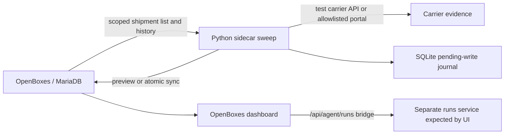

# OpenBoxes delayed-shipment project wiki

_Snapshot: 2026-09-23. This describes the local checkout and the evidence available here, not a production deployment._

## What this project is

This repository is a local build of [OpenBoxes](README.md), an open-source warehouse and inventory system. The application is a Grails 3.3.16 / Java project (`0.9.9-SNAPSHOT`) with a React dashboard, MariaDB-backed Docker setup, and an added Python 3.11 delayed-shipment sidecar. The local work aims to identify overdue inbound shipments, check carrier evidence, update a defensible expected delivery date, and leave an auditable history without receiving stock or changing inventory.

There are **two different definitions of delayed** in this checkout:

| Surface | Selection rule | Purpose |
| --- | --- | --- |
| Existing OpenBoxes dashboard widget | A shipped or partially received incoming movement whose `SHIPPED` event is older than the transport-mode threshold (Air: one calendar month; Sea: two; Land/Suitcase: one week). | Warehouse overview. Expected delivery date does not drive this widget. |
| Python sidecar sweep | A warehouse-scoped shipment with `expectedDeliveryDate` before the current UTC time and a nonterminal status. | Select candidates for carrier checks and ETA/audit updates. |

The distinction matters: a shipment can appear in one list and not the other. [Shipment notes](SHIPMENTS_IN_OPENBOXES.md) document the widget, domain model, and a separate 30-record local dashboard dataset (10 each of Air, Sea, and Land).

## System map

The executable sidecar is [`sidecar/main.py`](sidecar/main.py). It calls the restricted OpenBoxes shipment API through [`sidecar/tools/openboxes.py`](sidecar/tools/openboxes.py), uses [`sidecar/tools/carrier_api.py`](sidecar/tools/carrier_api.py) for EasyPost/Shippo test-mode tracking or [`sidecar/tools/web_surfer.py`](sidecar/tools/web_surfer.py) for an allowlisted LocalLTL browser portal, and stores uncertain writes in SQLite. [`sidecar/context.py`](sidecar/context.py) examines history before each carrier check. Normal mode asks a configured chat-completions model for a bounded `proceed`, `skip`, or `stop` classification; `CONTEXT_MODE=rules` is an explicit deterministic test/offline mode. Hard takeover and cooldown gates run before the model, and the model does not choose tools or authorize writes.

The OpenBoxes extension comprises [`ShipmentApiController.groovy`](grails-app/controllers/org/pih/warehouse/api/ShipmentApiController.groovy), [`ShipmentSidecarService.groovy`](grails-app/services/org/pih/warehouse/shipping/ShipmentSidecarService.groovy), a superuser-only sandbox seed endpoint, the `ROLE_SIDECAR_BOT` permission ceiling, and Liquibase migrations. The API offers paginated reads, shipment detail/history, ETA-only update, comments, custom events, and an atomic `/api/shipments/{id}/sync` operation. The sidecar uses `sync` for its write path. Each sync leaves one business event and one readable carrier/ETA comment. Server-side row locking, version checks, cooldown/takeover rechecks, and idempotency keys protect commits and retries. [Sidecar guide](sidecar/README.md) has the full contract.

The agent's required interface is **backend only**. The restricted bot can call `POST /api/shipments/{id}/comments` to add a comment and `POST /api/shipments/{id}/events` to add an allowlisted custom event. In the normal agent workflow it calls `POST /api/shipments/{id}/sync` once, which saves the comment, one outcome event, and optional ETA change in one transaction. The event is `Expected delivery date revised`, `Delivery status confirmed`, or `Delivery update requires review`. Technical evidence remains in audit metadata, not in the user-facing event name or comment. `GET /api/shipments/{id}/history` reads the saved records back. Each write needs an idempotency key, and `sync` also needs the current shipment version.

## Workflow and boundaries

1. The sidecar logs in as the warehouse-scoped `sidecar_bot` account and pages through shipments whose ETA has passed.
2. It reads each candidate's shipment and history. A terminal status, existing human-takeover marker, four-hour source-check cooldown, or newly future ETA prevents another check.
3. It checks the carrier identified by the shipment. Missing or ambiguous tracking, a missing/past/timezone-free **carrier ETA**, or other invalid evidence produces a human-review proposal. A shipment with no existing OpenBoxes ETA is not selected by the overdue sweep.
4. Without `--apply`, it prints proposals and makes no WMS writes. With `--apply`, it journals the complete payload, sends one atomic `sync`, and clears the journal only after a confirmed response. A later run replays the exact payload if the response was lost.
5. Successful sync may update `expectedDeliveryDate`; it writes one business event and a plain-language comment. Failed evidence writes a `Delivery update requires review` event and comment, with no ETA change. The workflow does not send messages, mark a shipment received, or change inventory.

The runtime bot is distinct from the earlier local `shipment-delayed-agent` account with `ROLE_SHIPMENT_CLERK`. The bot's exact role and account warehouse are checked independently of the selected session location, and its role is denied generic, user-management, and broad stock-movement endpoints. See [user and role notes](USER_MANAGEMENT_IN_OPENBOXES.md).

## Local setup and verification

The detailed, maintained commands and configuration are in [the sidecar README](sidecar/README.md). The short path is:

1. Build the executable WAR with `./gradlew bootRepackage -x generateGitProperties`, copy it to `docker/openboxes.war`, and start the Compose app with `docker/docker-compose.yml` plus `docker/docker-compose-sidecar.yml`. The override exposes nginx at `http://localhost/openboxes`, the app directly on port 8081, and reserves port 8080 for the portal fixture.
2. Install `sidecar/requirements.txt` into a Python 3.11 virtual environment and install Playwright Chromium. Configure process environment from [`sidecar/.env.example`](sidecar/.env.example); `.env` is not loaded automatically.
3. After deploying the migration, run `sidecar/seed.py` using a separate superuser login. It creates the restricted bot and two synthetic inbound shipments: `SHIP-2026-API1` (EasyPost) and `SHIP-2026-WEB1` (LocalLTL). Set the returned destination ID as `OPENBOXES_LOCATION_ID` for the bot.
4. From `sidecar/`, start `.venv/bin/uvicorn mock_server:app --host 127.0.0.1 --port 8080` for the portal fixture. For the fixed example use `CARRIER_FIXTURES=true` and `CONTEXT_MODE=rules`; run `.venv/bin/python main.py` for preview, then `.venv/bin/python main.py --apply` for the policy-authorized writes. [`sidecar/verify_live.py`](sidecar/verify_live.py) checks the two named fixtures, denied routes, replay safety, and no-op repeat behavior; its default invocation is read-only.

The fixture's revised ETA is **2026-09-24 10:00 UTC**. After that time, validation correctly sends it to human review instead of treating it as a future ETA. Carrier fixture responses are synthetic; real test-provider responses may differ. The seed endpoint is gated by `SIDECAR_SANDBOX_ENABLED=true` on the OpenBoxes server and should be disabled after setup.

## Current project state

The code, tests, local WAR, and documentation for the sidecar are present as working-tree changes; they are not all committed. An earlier entry in [the sidecar verification log](sidecar/VERIFICATION.md) reports 32 passing Python tests, one opt-in headless-browser test, seven status-mapping tests, 128 role/permission tests, and a successful executable WAR build. It also records a Docker storage failure that blocked deployment at that time.

After Docker Desktop restarted on **2026-09-23**, the Compose stack was rebuilt with the business-event change. The app and database are healthy, and `/openboxes/health` returns `UP`. Both fixtures now have the future ETA `2026-09-24T10:00:00Z`, `IN_TRANSIT` status, one readable comment, and one `Expected delivery date revised` event in their shipment history. The history API also returns that business wording as the event description. Older technical event types are inactive in the manual event selector; their detached audit rows remain in the database. A backup was saved before migration at `/private/tmp/openboxes-before-business-events-20260923.sql.gz`.

The Python sidecar runs from the host virtual environment; **Docker Compose runs OpenBoxes, MariaDB, and nginx, not the Python agent**. Grails tests and the executable WAR build passed because the event-writing logic and event-type migration live in OpenBoxes. The Python suite passed (32 tests; one optional browser test skipped), and the read-only `sidecar/verify_live.py` check passed restricted-route and history assertions after deployment. The fixture history was converted by a targeted migration; this inspection did not execute a fresh `--apply` write with the new business-event behavior.

The React [Shipment follow-ups panel](src/js/components/dashboard/AgentActivityPanel.jsx) and [Grails bridge](grails-app/controllers/org/pih/warehouse/agent/AgentApiController.groovy) are an optional, unfinished UI path. They expect a separate runs service at `openboxes.agent.serviceUrl`; the backend sidecar does not depend on it. The Python sidecar currently runs as a CLI sweep, and the FastAPI app here is a mock tracking portal.

## Next work

1. Before using the agent on new shipments, run a controlled `--apply` scenario against a fresh fixture and confirm the atomic write and replay behavior live. The two existing fixtures are already updated, so their current state can verify read behavior but cannot exercise a first write again without a new test case.
2. Keep the backend sweep as the current agent interface. If a dashboard workflow is wanted later, define and implement its separate runs-service contract.
3. Revisit the fixed-date fixtures after 2026-09-24 10:00 UTC, and add domain-reviewed carrier scenarios before treating model or provider behavior as production-ready.

For deeper implementation details, start with [sidecar setup and API contracts](sidecar/README.md), [recorded verification and deployment blocker](sidecar/VERIFICATION.md), [shipment data and dashboard behavior](SHIPMENTS_IN_OPENBOXES.md), and [user/role model](USER_MANAGEMENT_IN_OPENBOXES.md).
