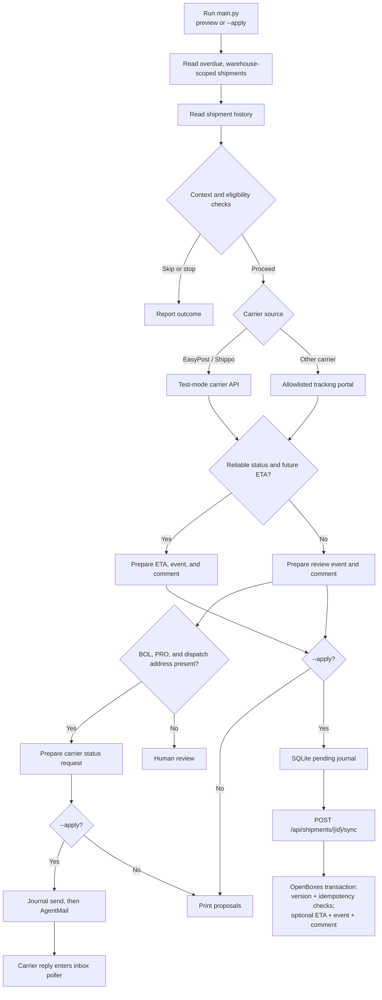
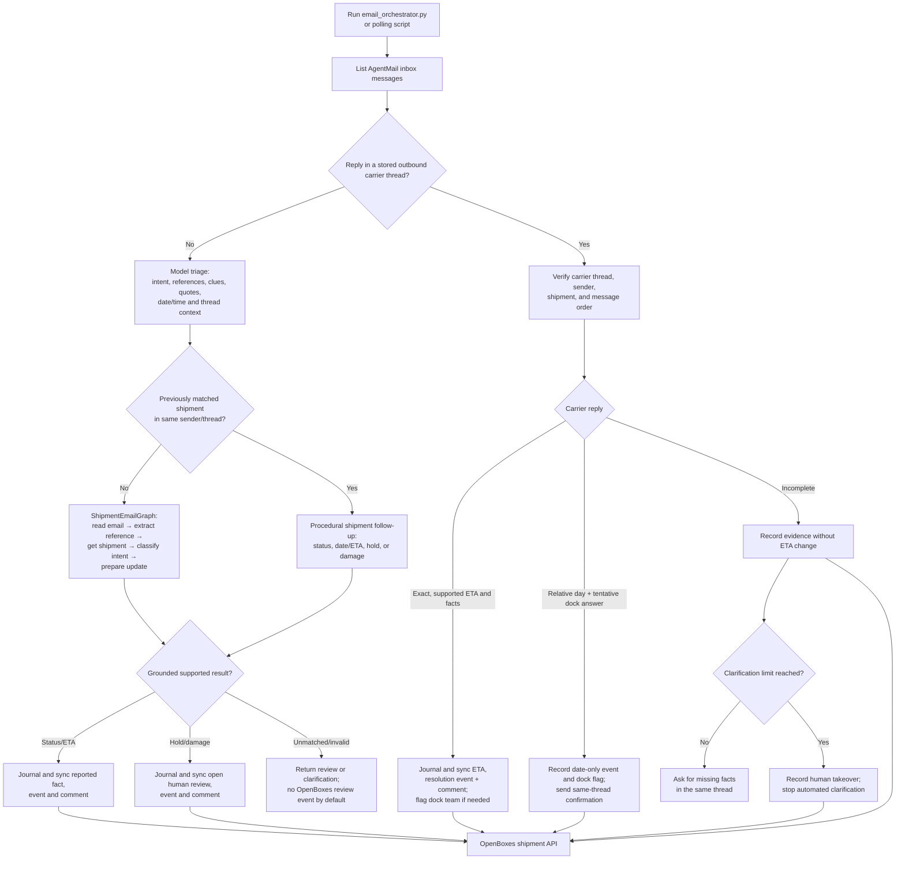

# Shipment agent orchestrator architecture

This document describes the agent code in this checkout as of 2026-09-26. The running implementation has two Python entry points: a delayed-shipment sweep and an AgentMail inbox poller. They share a restricted OpenBoxes shipment API and SQLite journals. There is no single central orchestrator service.

## Graph inventory and runtime boundaries

There are four compiled LangGraph graphs: two top-level graphs and two subgraphs owned by the case graph. The case graph is an opt-in workflow exercised by `try_case_graph.py`; `email_orchestrator.py --apply` uses the separate shipment email graph. The overdue sweep, same-thread email follow-ups, and carrier replies have procedural orchestration outside these graphs.

| Graph | Nodes and current capability | Runtime |
| --- | --- | --- |
| [`ShipmentCaseGraph`](../sidecar/case_graph.py) | Ingest authenticated AgentMail/OpenBoxes events; model-triage email intent, references, and search clues; resolve one shipment; route to investigation or review; validate an evidence brief; optionally draft an exact outbound message for approval; monitor. Ambiguous identity requires a verified human selection. | Opt-in library and `try_case_graph.py` demo. Not called by the sweep or inbox poller. |
| Case graph's investigator subgraph | Load the matched shipment, choose and validate a bounded carrier tracking read, save raw evidence, check source freshness, reconcile it with attributed email claims, and return a brief with conflicts, unknowns, and the next step. | Called by `ShipmentCaseGraph`. Currently makes at most one carrier read per investigation. |
| Case graph's voice subgraph | Reserve and place an approved call with an idempotency key; return the result as evidence for another investigation pass. | Guarded extension point. The current investigator never proposes `request_call`, so normal case runs cannot reach it. |
| [`ShipmentEmailGraph`](../sidecar/email_orchestrator.py) | `read_email → extract_reference → get_shipment → classify_intent → prepare_update`. Use model triage for shipment/tracking references or route/product/quantity clues, require one eligible OpenBoxes match, ground claims in the newest email, and prepare a status event or a human review for reported holds or damage. | Used for new shipment emails by `email_orchestrator.py`; its surrounding code journals and commits on `--apply`. |

The email poller first makes a model triage call with the newest message and attributed evidence from earlier messages in the same sender/thread. Its graph consumes that answer. Same-thread shipment ETA/date replies, business holds, and damage reports can take dedicated procedural follow-up handlers; carrier replies use `carrier_email.py`. A CLI result of `review` alone does not create an OpenBoxes review event. A prepared human-review payload must be committed with `--apply` before the shipment appears under **Needs Human Attention**.

## Durable case graph foundation

[`sidecar/case_graph.py`](../sidecar/case_graph.py) defines the parent `StateGraph` and its private investigator and voice subgraphs. It is an opt-in library; the sweep and inbox poller do not invoke it. A caller supplies authenticated AgentMail or OpenBoxes events, a stable episode `case_id`, scoped OpenBoxes and carrier readers, an immutable evidence store, a durable LangGraph checkpointer, and an approval verifier backed by its authenticated approval service. `sqlite_checkpointer(path)` uses `langgraph-checkpoint-sqlite`, declared in `sidecar/requirements.txt`. Local graph tests used `InMemorySaver`; `try_case_graph.py` is a separate manual demo that uses SQLite checkpoints and reads local OpenBoxes shipments with synthetic carrier evidence and mail receipts. It does not enable a real send. A deployment must exercise restart/resume and its authenticated approval service before enabling sends.

The parent handles ingestion, structured email triage, scoped identity resolution, deterministic routing, investigation, brief validation, drafting, exact-payload approval, conservative send reservation, and monitoring. Raw email and carrier responses are immutable SQLite evidence snapshots; graph state holds IDs, compact model audit metadata, and the brief. Unmatched or ambiguous email references pause for a human selection, and the selection requires a verified review record. Unsupported intents go to review. The investigator currently makes one fixed carrier read, requires a carrier event timestamp within 72 hours, preserves a conflicting email status claim, and routes unresolved evidence to review. Planner-driven second reads, official disruption search, model synthesis, full receipt closure, and scheduled rechecks are not connected yet.

Call approval is a node in the parent graph; voice is a subgraph. The current deterministic investigator never proposes `request_call`; no telephone action is reachable in this release. A future voice adapter receives a stable idempotency key and is protected by a conservative call reservation. A completed call returns to investigation and then human review until source-specific transcript parsing is added. The mail commit path rechecks the immutable proposal hash, approval record, shipment version/status, and stored dispatch recipient; a reserved send with an unknown provider result is not retried automatically.

The caller must verify webhook signatures before setting `authenticated=True`; the graph does not implement provider-specific signature verification. The approval verifier must validate approver identity, proposal hash, scope, and expiry. With no verifier, the graph can investigate but cannot send. No new public API or UI is attached to this graph yet. The manual CLI can read a real AgentMail message, start a case, and ingest a later message from the same thread. That reply is evidence and currently routes to review after investigation; automated follow-up drafting, receipt closure, and verified carrier reply resolution remain future work.

## Delayed-shipment sweep

The sweep starts in [`sidecar/main.py`](../sidecar/main.py). It finds overdue shipments, checks their history, selects a carrier evidence source, and prepares an OpenBoxes update. By default it prints proposals. `--apply` enables the journaled write and, when configured evidence is insufficient, a carrier dispatch request.

The sweep implementation is in [`sidecar/agent.py`](../sidecar/agent.py). [`sidecar/context.py`](../sidecar/context.py) applies hard history gates before an optional bounded model classification of `proceed`, `skip`, or `stop`. Code chooses the carrier tool and controls writes. The carrier tools are [`carrier_api.py`](../sidecar/tools/carrier_api.py) and [`web_surfer.py`](../sidecar/tools/web_surfer.py).

## AgentMail inbox poller

The poller starts in [`sidecar/email_orchestrator.py`](../sidecar/email_orchestrator.py), either directly or through [`trigger_email_agent.sh`](../sidecar/trigger_email_agent.sh) and [`watch_email_agent.sh`](../sidecar/watch_email_agent.sh). A message in a stored outbound carrier thread follows the carrier reply workflow. Other messages receive model triage, then enter the new-email graph or a same-thread shipment follow-up handler.

The email LangGraph handles new shipment emails, including grounded status updates and hold/damage review proposals. `process_polled_message` handles same-thread shipment follow-ups outside the graph and routes carrier replies into [`sidecar/carrier_email.py`](../sidecar/carrier_email.py). Without `--apply`, the poller returns proposals. With `--apply`, SQLite records pending writes so an uncertain OpenBoxes response can be retried with the same payload and idempotency key. A committed hold/damage review creates an OpenBoxes event that drives the human review page and **Needs Human Attention** list filter; a CLI `review` result from a failed validation does not. Outbound mail sends are reserved before sending; uncertain sends are not automatically repeated.

## Shared OpenBoxes boundary

Both entry points use [`sidecar/tools/openboxes.py`](../sidecar/tools/openboxes.py) to access the narrow `/api/shipments` endpoints. [`ShipmentApiController.groovy`](../grails-app/controllers/org/pih/warehouse/api/ShipmentApiController.groovy) forwards requests to [`ShipmentSidecarService.groovy`](../grails-app/services/org/pih/warehouse/shipping/ShipmentSidecarService.groovy). The service enforces the account's warehouse scope, locks the shipment for mutation, checks terminal and takeover state, validates version and idempotency, and saves the optional ETA, business event, and comment in one transaction. The sidecar cannot receive stock or change inventory through this API.

The dashboard [`AgentActivityPanel.jsx`](../src/js/components/dashboard/AgentActivityPanel.jsx) and [`AgentApiController.groovy`](../grails-app/controllers/org/pih/warehouse/agent/AgentApiController.groovy) are a separate, unfinished runs-service path. They expect a service at `openboxes.agent.serviceUrl`. The current Python orchestrators run as CLI processes and do not implement that runs service.
